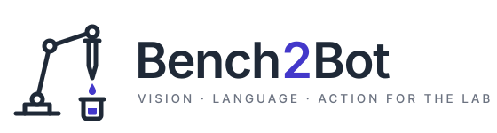
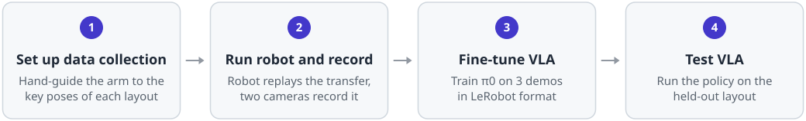

  <picture>
    <source media="(prefers-color-scheme: dark)" srcset="figures/logo/bench2bot-logo-dark.svg">
    
  </picture>

# Bench2Bot: Learning Chemistry from Demonstration

Project 4 of the **AIchemy Winter School 2026: Robotics and AI for Chemistry**.

## Goal

We provide a **proof of concept** for teaching a robot arm a liquid transfer from demonstration: we record demonstrations on a UR5e and use them to fine-tune a state-of-the-art Vision-Language-Action (VLA) model. The task is to pick up a pipette, aspirate from a source vial and dispense into a target vial on a stirring hot plate. The trained policy should still work when the pipette holder and vials are moved to new positions.

## Pipeline

  <picture>
    <source media="(prefers-color-scheme: dark)" srcset="figures/pipeline/pipeline-dark.svg">
    
  </picture>

### 1. Set up data collection

We place the pipette holder and vials in **4 different layouts**. For each layout we guide the arm by hand to the key poses of the transfer. Two cameras observe the scene: a fixed **world camera** and a **wrist camera** on the arm.

### 2. Run robot and record

For each layout the robot replays the transfer while both cameras record. This gives **4 demonstrations**, which are converted to the [LeRobot](https://github.com/huggingface/lerobot) format.

### 3. Fine-tune VLA

We fine-tune **[π0](https://arxiv.org/abs/2410.24164)** (pi-zero), an open VLA model from Physical Intelligence, on **3 of the 4 demonstrations**. π0 takes the camera images, the robot state and a language prompt, and outputs the next robot actions. Because it is pre-trained on data from many robots, it can be adapted to a new task with few demonstrations.

### 4. Test VLA

We keep the fourth demonstration for testing, so the test layout is one the model has not seen. We run the fine-tuned policy on the robot in this layout to check whether it still completes the transfer when the pipette holder and vials are in new positions.
