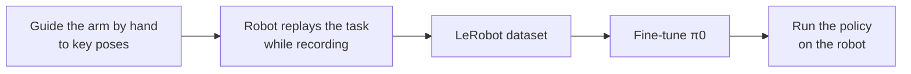

  <picture>
    <source media="(prefers-color-scheme: dark)" srcset="figures/logo/bench2bot-logo-dark.svg">
    
  </picture>

# Bench2Bot: Learning Chemistry from Demonstration

Project 4 of the **AIchemy Winter School 2026: Robotics and AI for Chemistry**.

## Goal

We provide a **proof of concept** for teaching a robot arm a liquid transfer from demonstration: we record demonstrations on a UR5e and use them to fine-tune a state-of-the-art Vision-Language-Action (VLA) model. The task is to pick up a pipette, aspirate from a source vial and dispense into a target vial on a stirring hot plate. The trained policy should still work when the pipette holder and vials are moved to new positions.

## Data

We recorded **4 demonstrations**, changing the positions of the pipette holder and vials each time. For each layout we guided the arm by hand to the key poses, then let the robot replay the transfer while recording from two cameras: a fixed **world camera** and a **wrist camera** on the arm. The recordings are converted to the [LeRobot](https://github.com/huggingface/lerobot) format. We fine-tune on **3 demonstrations** and keep **1 for testing**, so the test layout is one the model has not seen.

## Model

We fine-tune **[π0](https://arxiv.org/abs/2410.24164)** (pi-zero), an open VLA model from Physical Intelligence. It takes the camera images, the robot state and a language prompt, and outputs the next robot actions. Because it is pre-trained on data from many robots, it can be adapted to a new task with few demonstrations.

